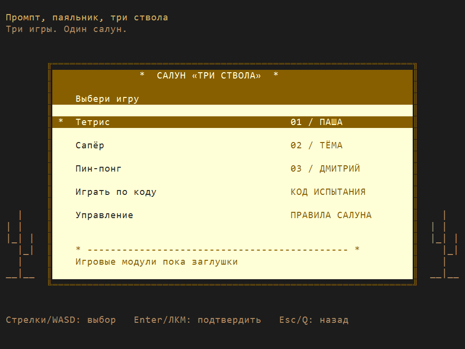
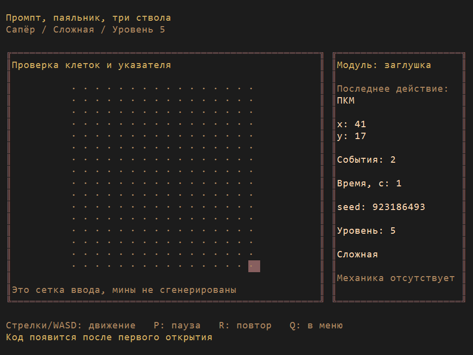

# Проверка основы — 19 ноября 2026

Проверена локальная версия с тремя игровыми заглушками. Здесь нет утверждения о
готовности механик игр или выполнении всех конкурсных критериев.

## Среда и сборка

Windows: ESP-IDF v5.5.1, ESP32, GCC 14.2.0 (esp-14.2.0_20241119), C++17,
CMake 3.30.2, Ninja 1.12.1, Python 3.12.0. QEMU 9.0.0
(esp_develop_9.0.0_20240606), GDB 16.2_20250324.
Команда: `powershell -ExecutionPolicy Bypass -File tools/build.ps1`.
Сборка завершена; минимальный набор компонентов включён.
SHA-256 gaming_mps.bin: `0842ca207f8a1f459e250e862919c8b4f03d9d2240a7a006a2d1b7fbbc50d6d0`.

## Выполненные проверки

- Общий C++ код: GCC для ПК, -Wall -Wextra -Werror, AddressSanitizer/UBSan,
  `ASAN_OPTIONS=detect_leaks=0`; ошибок не получено. Это дополнительные тесты в Linux,
  не обязательная зависимость для Windows-разработчиков.
- Проверены фрагментированные стрелки/SGR, CRLF, одиночный Esc, переполнение
  буфера, выход координат за диапазон, переход счётчика времени через UINT32_MAX.
- Код испытания сверяется с независимым вектором, вычисленным Python struct/binascii:
  `P1-041020-R00007-GNHM2B-ZZYZJ4`. Проверены допустимые игры, сложности, уровни,
  граничные первые клетки и повреждение CRC. Ошибка не меняет выходные настройки.
- Победа, поражение, пауза, сохранение seed при повторе, следующий уровень и
  финальный уровень проверены с управляемыми игровыми двойниками.
- В настоящем QEMU по UART проверены меню, настройки, три заглушки, поле 16×16,
  ЛКМ, ПКМ, наведение, уход с поля, запрет внешних кликов, пауза/повтор/возврат,
  новый seed, ввод корректного и повреждённого кода, справка.
- Отдельная нативная консоль Windows проверила ReadConsoleInputW, клавиатуру,
  кнопки и перемещение мыши через общий запускатель до прошивки и обратно.
  Вход подавался синтетическими WriteConsoleInputW-записями в собственную консоль
  теста; физические клики пользователя не проверялись. После каждого проверенного
  перехода все 80×30 символов настоящего буфера ReadConsoleOutputCharacterW
  совпали с кадром прошивки, включая возврат из игры.
- Ошибка прежнего stdout.buffer воспроизведена отдельным тестом: разбиение UTF-8
  по одному байту давало U+FFFD и расширяло строки. Новый вывод сохраняет состояние
  декодера между порциями UART и использует WriteConsoleW. Тест того же разбиения
  проверяет реальные русские буквы, рамки и символ в столбце 80 — PASS.
  Прежняя проверка только восстановленного UART-кадра эту ошибку пропустила.
- GDB остановился в app_main настоящей прошивки и выполнил два next, меняя PC:
  0x400d3f9c → 0x400d3f9f → 0x400d3fc2. Источник — main/main.cpp.
  Присутствует предупреждение GDB о CP1252/UTF-32, не помешавшее отладке.
- Doxygen 1.18.0 создал HTML документацию; WARN_AS_ERROR=FAIL_ON_WARNINGS,
  предупреждений и ошибок нет. Собственные файлы прошивки меньше 2000 строк.

Физический JTAG не проверялся. GitHub Actions настроен, но эта версия workflow
ещё не запускалась в GitHub. Реальный прогон на втором компьютере не выполнен.

## Подтверждения

- [Завершение сборки](evidence/build.txt).
- [Результаты QEMU и нативной консоли](evidence/checks.txt).
- [Шаги GDB](evidence/gdb-step.txt).

Изображения ниже — кадры прошивки, восстановленные из реальных UART-данных,
а не скриншоты рабочего стола Windows.

Полные локальные логи и кадры создаются в artifacts/, генерируемая HTML
документация — в docs/html/. Они исключены из Git.
